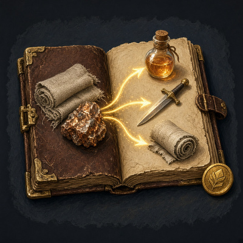
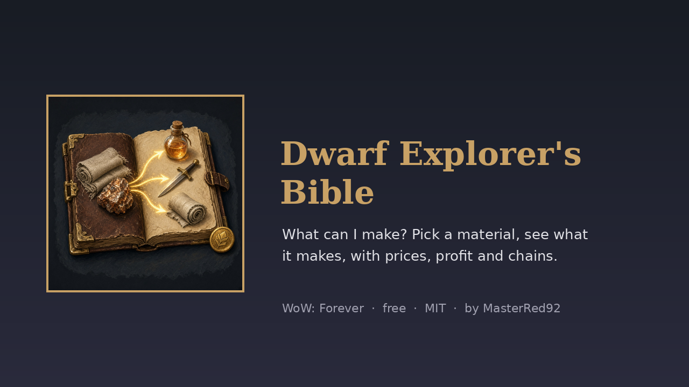
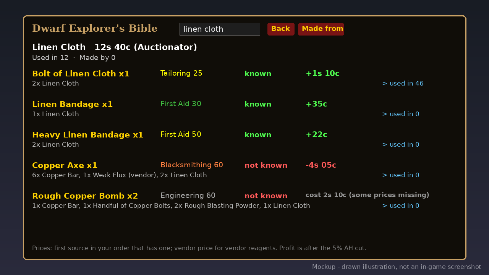

# Dwarf Explorer's Bible (WoW: Forever) v1.2.0

   

**What can I make with this?** Pick any material and Dwarf Explorer's Bible shows every recipe that uses it, what each one is worth at the auction house right now, and where the result goes next.

- **Pick a material:** Alt-click any item (bags, chat links, loot, the AH), type `/deb linen cloth`, paste a link, or use the search box. Results show as you type and match the start of words: "copp" finds Copper Bar and Handful of Copper Bolts.
- **Every recipe that uses it:** profession, skill level (orange when it's above yours), the other reagents, and whether you know the recipe. "Show only" boxes (Known, My professions, Has a price) are remembered; only My professions is ticked at first.
- **Prices and profit:** the latest auction price for the material, every reagent and every crafted result, the reagent cost, and the estimated profit after the 5% AH cut. Each price says which addon it came from.
- **Follow the chain:** the chain strip (from recipe data, not your page history) shows this material, the recipe you point at and that result's most profitable next step; before you point at one, it shows this material's own most profitable chain. It stays on the last row you pointed at. Click a row (or a step in the strip) to open that item. Back and the breadcrumb walk the chain back. "Made from" flips to the recipes that create the item.
- **Drops from kills:** loot a mob's corpse and the addon counts the trade goods in it (once per corpse). After 20 kills of a mob (yours, plus any you import or receive from other Dwarf Explorer's Bible users in your party or guild), its tooltip and the material page's "Drops from" section show the drop rate, labelled "from N kills"; until then its tooltip says "Learning drops: N of 20 kills". There is no bundled loot database. Export and Import buttons (and `/deb export` / `/deb import`) copy a drop string you can paste in Discord or to another player; the addon also shares your own counts automatically with party and guild members who use it, once you are out of combat.
- **Tooltip line:** "Used in N recipes (Dwarf Explorer's Bible)", with its price and source. Herb seeds show their camp uses (plant at a Greenhouse, hybridize at a Seed Hybridizer, which can fail since the Nov 19 hotfix; Scarce Herb Seeds can only be planted), Black Lotus says a vendor sells it, and the potion copies that can't go into recipes say so.
- **LDB launcher** for Titan Panel, ChocolateBar and other broker displays.

## Price sources
Dwarf Explorer's Bible reads prices from whichever price addon you already use. The first source in your order that has a price wins:

| Source | API used | Forever (16001) build |
| --- | --- | --- |
| [PriceLog](https://github.com/masterred92/PriceLog) (mine) | `KennyPriceLog.GetLatest(itemID)` | Yes |
| [Auctionator](https://www.curseforge.com/wow/addons/auctionator) | `Auctionator.API.v1.GetAuctionPriceByItemID` | Yes (341, Oct 13 2026) |
| [TradeSkillMaster](https://tradeskillmaster.com) | `TSM_API.GetCustomPriceValue("DBMarket")`, then `DBMinBuyout` | Not yet; works when it ships one |
| [Auctioneer (Forever)](https://www.curseforge.com/wow/addons/auctioneer-forever) | `AucAdvanced.API.GetMarketValue` | Yes (4.0.0) |
| Dwarf Explorer's Bible scan | prices it sees in AH searches **you** do | Always on |

No price addon? It still works: every AH search you make (browse or commodity) is cached. It never searches on its own.
Change the order with `/deb prefer auctionator` or `/deb order tsm,auctionator,scan`; `/deb sources` shows the order and what's installed.

## Where the recipes come from
The recipe list (2,090 recipes across Alchemy, Blacksmithing, Comprehension, Cooking, Enchanting items, Engineering, First Aid, Fishing, Herbalism, Leatherworking, Mining, Poisons, Skinning and Tailoring) comes from **WoW: Forever's own client tables plus the server hotfixes Blizzard has pushed on top of them** (build 1.60.1.71037, via [wago.tools](https://wago.tools)), so it has Forever's reagents and skill levels, not vanilla's: for example Minor Healing Potion in Forever uses an Empty Vial, Mild Spices and Peaceblooms, and the Tanning Rack turns grey at 125 since the Nov 9 hotfix. `tools/fetch_hotfixes.py` and `tools/gen_data.py` regenerate it after a patch or hotfix. Recipes whose item Blizzard still keeps out of the game files (for example the Artisan's Tier Fel Leather pieces) are listed under the recipe's name and marked "Not released yet". The row tooltip also lists any tool a recipe needs in your bags. Skill levels are where a recipe turns yellow and grey, coloured against your own skill. Each time you open a profession window the addon also records what you know and adds any recipe the bundled list doesn't have. A few camp changes Blizzard made on the server only (the Nov 19 hotfix: Hybridize Seeds can fail, Scarce Herb Seeds can't be hybridized) are applied from Blizzard's hotfix notes; Blizzard hasn't published the failure chance, so the addon only says it can fail.

## Drops from kills
When you open a mob's corpse, the addon reads the loot window (it never loots, targets or clicks anything). It keeps, per mob, how many of its corpses you've looted and how many had each trade good, in your SavedVariables. Each corpse counts once, even if you reopen it or `/reload`. If the game hides any value in the window (the mob or an item), that corpse is skipped rather than counted half-seen, and stays skipped if you reopen it. Loot from items, fishing, chests, Pick Pocket, and skinning, mining, herbing or opening right after you cast it is left out (those spells come from the game's own spell tables); other casts don't matter, and a mob you pick-pocketed still counts once you kill and loot it. A rate shows only after 20 combined kills of that mob. Corpses with no loot at all can't be opened, so rates lean a little high.

You can share those counts. **Export Drops** (or `/deb export`) opens a window with a drop string already selected: press Ctrl+C (or Copy) and paste it in Discord or a message. **Import Drops** (or `/deb import`) accepts a string immediately and adds it to your rates. In a party, raid or guild, the addon also sends your own counts to other Dwarf Explorer's Bible users automatically, but only out of combat and never as a visible chat message. Only the kills you recorded yourself are exported or sent, never the list of corpse GUIDs the addon uses to avoid counting the same corpse twice, and never numbers you already imported from someone else. Each string carries an id for the account that made it: importing or receiving the same id again replaces that account's numbers instead of adding them a second time, so pasting the same string twice does nothing. Numbers from different accounts are added together and shown as one rate, labelled "from N kills".

**Reagent cost** uses the vendor price for reagents a vendor sells (thread, flux, vials, spices, dyes), as Auctionator's crafting view does: learned from merchant windows you open, else Forever's listed price. Everything else uses the auction price. Black Lotus, which Blizzard says a Forever vendor sells, is never costed above the vendor price once you've seen that vendor's window. Profit is shown only when every reagent and the result have a price, so a missing price can't make a recipe look better than it is.

## How it's different
Reverse lookups exist ([Recipe Master by BrenoLudgero](https://www.curseforge.com/wow/addons/recipe-master), ATT, Auctionator's crafting info, TSM's crafting tab, CraftSim on retail, Crafting Dictionary on retail), but they either track which recipes you're missing, price recipes you already know, or start from the recipe rather than the material. This one starts from the material, prices every option from your own AH addon, and lets you walk the chain material > intermediate > final, like the Guide in Terraria.

## Commands
`/deb` (or `/craftguide`) open · `/deb <name, link or itemID>` · `sources` · `prefer <id>` · `order a,b,c` · `tooltip` · `altclick` · `export` · `import` · `report` · `help`. Source ids: `pricelog`, `auctionator`, `tsm`, `auctioneer`, `scan`.

## Download
- **Wago Addons:** [Dwarf Explorer's Bible on Wago](https://addons.wago.io/addons/dwarfexplorersbible)
- **CurseForge:** [Dwarf Explorer's Bible on CurseForge](https://www.curseforge.com/wow/addons/dwarf-explorers-bible)
- **GitHub:** [Releases](https://github.com/masterred92/DwarfExplorersBible/releases) · [Issues](https://github.com/masterred92/DwarfExplorersBible/issues)
- **More by Kenny:** [PriceLog](https://github.com/masterred92/PriceLog) · [MatTooltip](https://github.com/masterred92/MatTooltip) · [NeutralFlip](https://github.com/masterred92/NeutralFlip) · [GoldPerSpot](https://github.com/masterred92/GoldPerSpot) · [all WoW: Forever addons](https://github.com/masterred92/wow-forever-addons)

## Install
Put the `DwarfExplorersBible` folder in `World of Warcraft\_forever_\Interface\AddOns\` and restart the game or `/reload`.

## In-game test checklist (launch day)
1. Listed in AddOns with its icon.
2. Hover Linen Cloth: "Used in N recipes (Dwarf Explorer's Bible)". Alt-click it: the guide opens on Linen Cloth.
3. `/deb copper bar` opens Copper Bar; the chain strip shows Copper Bar's own chain. Point at a row: the strip switches to it and stays after the mouse leaves. Click the row: that item opens, and Back returns.
4. Type "copp" in the search box: results appear as you type; Enter opens the top one. Untick My professions, `/reload`: it stays unticked.
5. Kill and loot one mob: its tooltip says "Learning drops: 1 of 20 kills". After 20 kills it shows trade-goods rates "from 20 kills" instead, and the material's "Drops from" line lists it. Click + to open the list; -, Escape and Back each close it. Export Drops and Import Drops sit on the same row.
6. Open each profession window: your known recipes turn green and your skill shows; a Forever-only recipe appears with "from your profession window".
7. With Auctionator installed and a scan done, prices say "(Auctionator)". Turn it off: an AH search you do shows "(Dwarf Explorer's Bible scan)".
8. `/deb prefer scan` and `/deb sources` show the new order; it survives `/reload`.
9. Titan Panel or another broker display shows the launcher.

## Credits
- Idea from Kenny's mate, who asked for "the Guide from Terraria, but for WoW, with auction prices".
- Inspired by the Guide NPC in Terraria (Re-Logic) and the tModLoader Recipe Browser mod's way of showing "what can I make from this". No code from either.
- Recipe data: WoW: Forever 1.60.1.71037 client tables and server hotfixes via [wago.tools](https://wago.tools); vendor-sold flags from [nexus-devs/wow-classic-items](https://github.com/nexus-devs/wow-classic-items) (MIT).

## Licence
MIT. Written from scratch; no code copied from other addons. Free, no paid features. It doesn't automate anything: it only shows information, only caches AH prices from searches you make yourself, and only reads loot windows you open.

## Development
`tests/run.sh [path-to-wow-ui-source-forever]` runs `luac -p`, luacheck, the mock-client tests (every price source is mocked) and (with a path) an API check against Blizzard's Forever UI source. GitHub Actions runs the tests on every push. `tools/fetch_hotfixes.py <build> <Table> <out.json>` downloads that build's server hotfixes for one table, and `tools/gen_data.py <csv-dir> --build <build> --hotfixes <dir> [--vendor data.json]` regenerates `Data.lua` from the client tables with the hotfixes applied (the header comment in `gen_data.py` lists the tables; `--list-hidden` prints the item IDs whose ItemSparse hotfixes to fetch). Pushing a `v*` tag packages a full release with [BigWigsMods/packager](https://github.com/BigWigsMods/packager) and publishes it to CurseForge, Wago Addons and GitHub Releases (project IDs are in the TOC).
