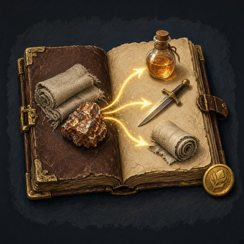
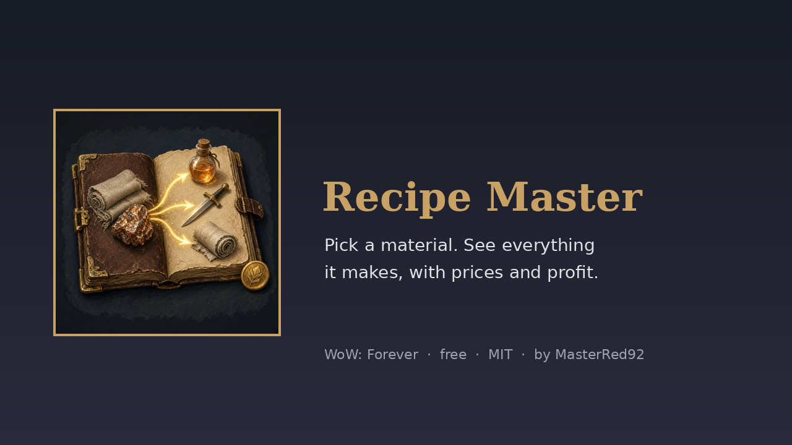
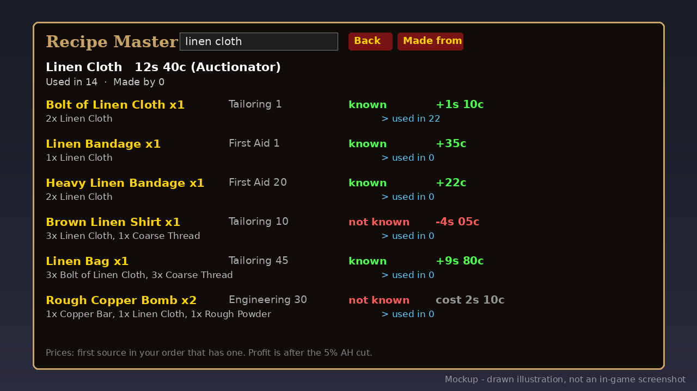

# Recipe Master (WoW: Forever) v1.0.0

   

**"What can I make with this?"** Pick any material and Recipe Master shows every recipe that uses it, what each one is worth at the auction house right now, and where the result goes next.

- **Pick a material:** Alt-click any item (bags, chat links, loot, the AH), type `/rmaster linen cloth`, paste a link, or use the search box.
- **Every recipe that uses it:** profession, skill level (orange when it's above yours), the other reagents, and whether you know the recipe.
- **Prices and profit:** the latest auction price for the material, every reagent and every crafted result, the reagent cost, and the estimated profit after the 5% AH cut. Each price says which addon it came from.
- **Follow the chain:** click a result to see what *that* makes: Linen Cloth > Bolt of Linen Cloth > Linen Bag. Back walks the chain back. "Made from" flips to the recipes that create the item.
- **Tooltip line:** "Recipe Master: used in N recipes", with its price and source.
- **LDB launcher** for Titan Panel, ChocolateBar and other broker displays.

## Price sources
Recipe Master reads prices from whichever price addon you already use. The first source in your order that has a price wins:

| Source | API used | Forever (16001) build |
| --- | --- | --- |
| [PriceLog](https://github.com/masterred92/PriceLog) (mine) | `KennyPriceLog.GetLatest(itemID)` | Yes |
| [Auctionator](https://www.curseforge.com/wow/addons/auctionator) | `Auctionator.API.v1.GetAuctionPriceByItemID` | Yes (341, Oct 13 2026) |
| [TradeSkillMaster](https://tradeskillmaster.com) | `TSM_API.GetCustomPriceValue("DBMarket")`, then `DBMinBuyout` | Not yet; works when it ships one |
| [Auctioneer (Forever)](https://www.curseforge.com/wow/addons/auctioneer-forever) | `AucAdvanced.API.GetMarketValue` | Yes (4.0.0) |
| Recipe Master scan | prices it sees in AH searches **you** do | Always on |

No price addon? It still works: every AH search you make (browse or commodity) is cached. It never searches on its own.
Change the order with `/rmaster prefer auctionator` or `/rmaster order tsm,auctionator,scan`; `/rmaster sources` shows the order and what's installed.

## Where the recipes come from
Vanilla recipes (1,115 of them across Alchemy, Blacksmithing, Cooking, Enchanting items, Engineering, First Aid, Leatherworking, Mining and Tailoring) are bundled, generated by `tools/gen_data.py` from [nexus-devs/wow-classic-items](https://github.com/nexus-devs/wow-classic-items) (MIT, credit to its authors). On top of that, each time you open a profession window Recipe Master records what you know, and adds any recipe the bundled data doesn't have (new Forever recipes, enchants). It only stores names of items you could already see, so it doesn't spoil Forever's hidden items.

## How it's different
Reverse lookups exist ([Recipe Master by BrenoLudgero](https://www.curseforge.com/wow/addons/recipe-master), ATT, Auctionator's crafting info, TSM's crafting tab, CraftSim on retail), but they either track which recipes you're missing, price recipes you already know, or start from the recipe rather than the material. This one starts from the material, prices every option from your own AH addon, and lets you walk the chain material > intermediate > final, like the Guide in Terraria.

## Commands
`/rmaster` (or `/craftguide`) open · `/rmaster <name, link or itemID>` · `sources` · `prefer <id>` · `order a,b,c` · `tooltip` · `altclick` · `report` · `help`. Source ids: `pricelog`, `auctionator`, `tsm`, `auctioneer`, `scan`.

## Download
- **Wago Addons:** coming at launch (Nov 4). The link goes here when the project is live.
- **CurseForge:** maybe later.
- **GitHub:** [Releases](https://github.com/masterred92/RecipeMaster/releases) (from the first tagged release) · [Issues](https://github.com/masterred92/RecipeMaster/issues)
- **More by Kenny:** [PriceLog](https://github.com/masterred92/PriceLog) · [MatTooltip](https://github.com/masterred92/MatTooltip) · [NeutralFlip](https://github.com/masterred92/NeutralFlip) · [all WoW: Forever addons](https://github.com/masterred92/wow-forever-addons)

## Install
Put the `RecipeMaster` folder in `World of Warcraft\_forever_\Interface\AddOns\` and restart the game or `/reload`.

## In-game test checklist (launch day)
1. Listed in AddOns with its icon.
2. Hover Linen Cloth: "Recipe Master: used in N recipes". Alt-click it: the guide opens on Linen Cloth.
3. `/rmaster copper bar` opens Copper Bar; click a result and Back returns.
4. Open each profession window: your known recipes turn green and your skill shows; a Forever-only recipe appears with "from your profession window".
5. With Auctionator installed and a scan done, prices say "(Auctionator)". Turn it off: an AH search you do shows "(Recipe Master scan)".
6. `/rmaster prefer scan` and `/rmaster sources` show the new order; it survives `/reload`.
7. Titan Panel or another broker display shows the launcher.

## Credits
- Idea from Kenny's mate, who asked for "the Guide from Terraria, but for WoW, with auction prices".
- Inspired by the Guide NPC in Terraria (Re-Logic) and the tModLoader Recipe Browser mod's way of showing "what can I make from this". No code from either.
- Recipe data: [nexus-devs/wow-classic-items](https://github.com/nexus-devs/wow-classic-items), MIT.

## Licence
MIT. Written from scratch; no code copied from other addons. Free, no paid features. It doesn't automate anything: it only shows information, and only caches AH prices from searches you make yourself.

## Development
`tests/run.sh [path-to-wow-ui-source-forever]` runs `luac -p`, luacheck, the mock-client tests (every price source is mocked) and (with a path) an API check against Blizzard's Forever UI source. GitHub Actions runs the tests on every push. `tools/gen_data.py data.json` regenerates `Data.lua`. The release workflow is a manual dry run that builds the zip with [BigWigsMods/packager](https://github.com/BigWigsMods/packager); publishing is switched off until the Wago project ID is added (see `.github/workflows/release.yml`).
